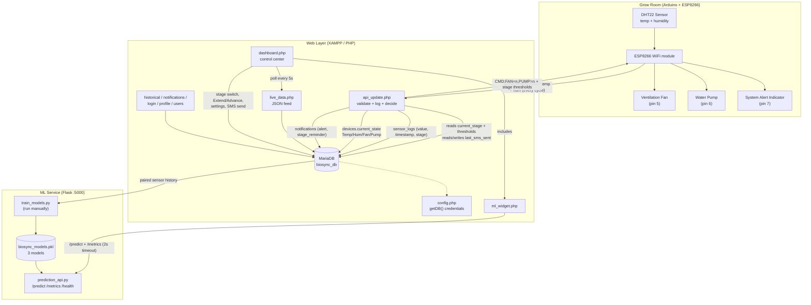
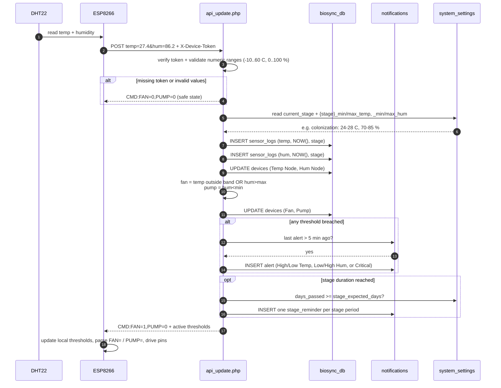
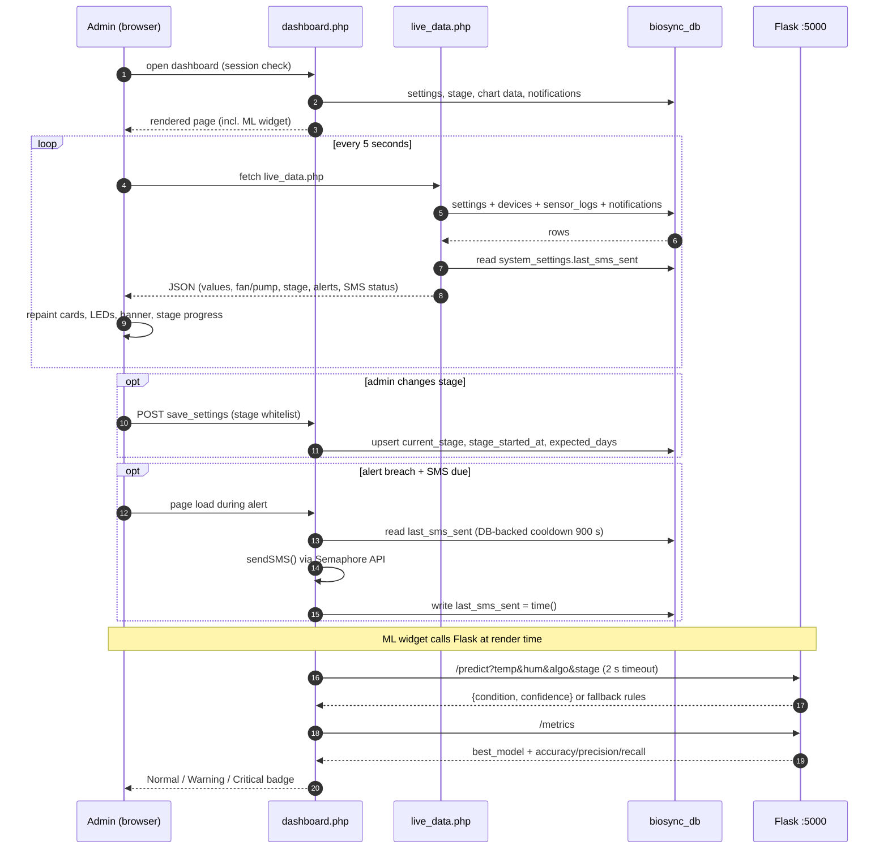
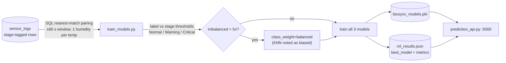

# BIO-SYNC — System Diagrams

Mermaid diagrams of the Bio-Sync mushroom-growing monitoring & automation system (stage-based thresholds). GitHub renders these blocks natively.

---

## 1. System Flowchart — Data & Control Flow

### Hardware command mapping (from `CMD:FAN=n,PUMP=n`)

| Command | Meaning | Hardware response |
|---|---|---|
| `FAN=1` | Temp **above max** (fan ON cools) — or **below min** (design question: no heater) | Relay pin 5 HIGH |
| `FAN=0` | Temp inside stage band | Relay pin 5 LOW |
| `PUMP=1` | Humidity below stage minimum | Relay pin 6 HIGH |
| `PUMP=0` | Humidity at or above stage minimum | Relay pin 6 LOW |
| `FAN=1` | Temperature outside band or humidity above stage maximum | Relay pin 5 HIGH |

---

## 2. Sequence Diagram — One ESP8266 Reading Cycle

## 3. Sequence Diagram — Dashboard Poll + ML Prediction (every 5 s)

## 4. ML Training Flow (manual step)

---

**Stage thresholds used everywhere (RRL Table 1):**

| Stage | Temp | Humidity | Default days |
|---|---|---|---|
| Colonization | 24–28 °C | 70–85 % | 14 |
| Pinning Initiation | 18–24 °C | 85–95 % | 7 |
| Fruiting | 24–28 °C | 80–95 % | 5 |
