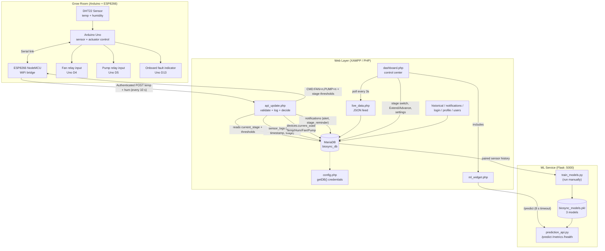
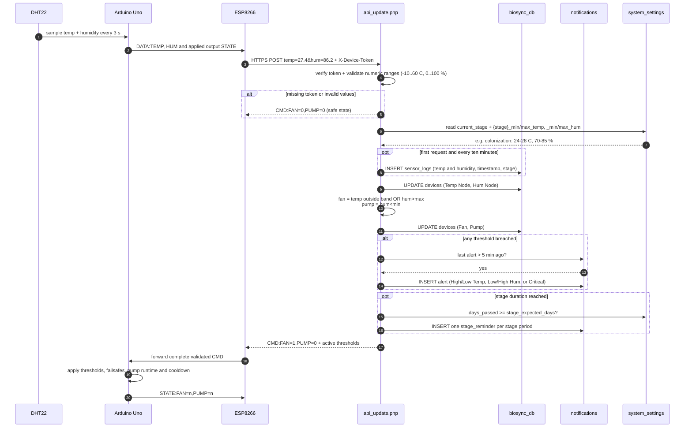
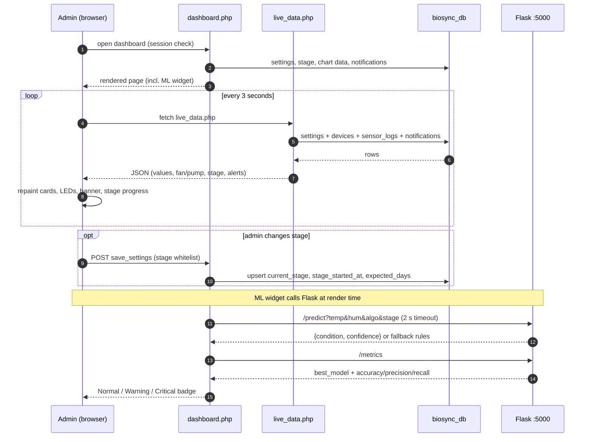
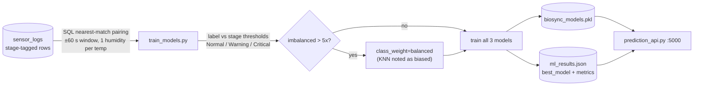

# BIO-SYNC — System Diagrams

Mermaid diagrams of the Bio-Sync mushroom-growing monitoring & automation system (stage-based thresholds). GitHub renders these blocks natively.

---

## 1. System Flowchart — Data & Control Flow

### Hardware command mapping (from `CMD:FAN=n,PUMP=n`)

| Command | Meaning | Hardware response |
|---|---|---|
| `FAN=1` | Auto: temperature above max or humidity above max. Manual: requested ON. No low-temperature heating action. | Uno D4 asserted LOW (active-low relay input) |
| `FAN=0` | Auto thresholds do not request cooling, or Manual request is OFF; failsafe also forces OFF. | Uno D4 HIGH (relay off) |
| `PUMP=1` | Auto: humidity below stage minimum. Manual: requested ON. | Uno D5 asserted LOW only when sensor/command are valid and pump runtime/cooldown allow it |
| `PUMP=0` | Not requested, humidity above stage maximum, failsafe, runtime limit, or cooldown. | Uno D5 HIGH (relay off) |

The Uno enforces a 10-second maximum continuous pump run and a 60-second cooldown
after every stop. Relay input polarity must be verified with the actual module.

---

## 2. Sequence Diagram — One ESP8266 Reading Cycle

## 3. Sequence Diagram — Dashboard Poll + ML Prediction (every 3 s)

## 4. ML Training Flow (manual step)

---

**Stage thresholds used everywhere (RRL Table 1):**

| Stage | Temp | Humidity | Default days |
|---|---|---|---|
| Colonization | 24–28 °C | 70–85 % | 14 |
| Pinning Initiation | 18–24 °C | 85–95 % | 7 |
| Fruiting | 24–28 °C | 80–95 % | 5 |
